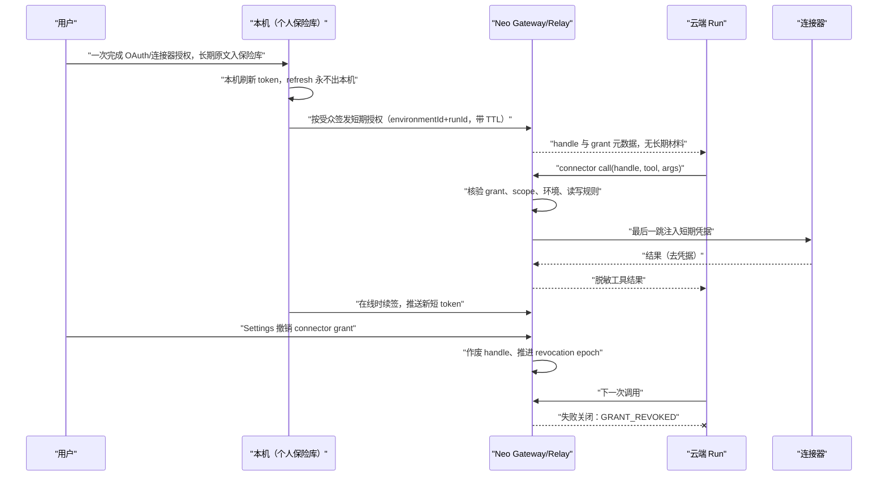
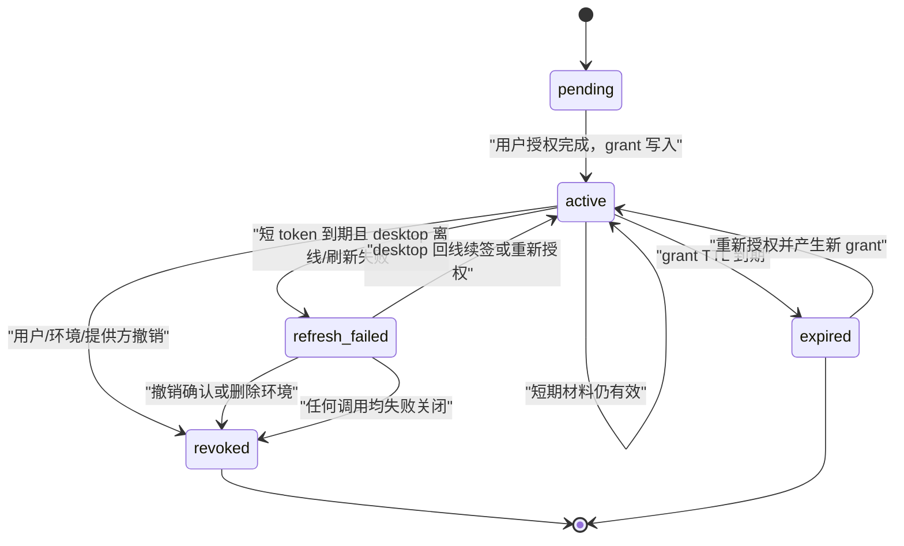

# ADR-085：云端运行使用用户已连接的应用：作用域授权，凭据不进模型上下文与云端日志

- 状态：**草稿·待爸拍板**
- 单号：N-CLOUD-CONNECTOR-AUTH
- 基线：`origin/main@991384746db0`（r2 起改为 merge 基线；初稿基线 `origin/main@5f6dce369a72`）
- 相关：ADR-076-sandbox-tool-layer（无连接器凭据章节）；ADR-081-execution-environment（N-CLOUD-ENV-ADR，已接受：决策 2 规定云端轮携带用户连接器授权，2026-10-05 拍板 5 把「连接器凭据边界」三句 + 泄露演练口径定为施工合同，其后续施工单表把本单范围定为「按受众签发和作废短期连接器授权，长期原文留在个人保险库」）；ADR-083（桌面常驻宿主，已接受，影响 desktop offline 失败腿）；ADR-050（`secureref:` 凭据引用）；ADR-051（连接器用户级落点）；ADR-066（出网域名白名单与凭据占位，待拍板、未施工）；ADR-075（审批停车语义）；N-CLOUD-CONNECTOR-REACH；N-ROLEWAKE-TOOLSCOPE；N-CLOUD-CRON-APPROVAL
- 关系说明：当前树中 `ADR-076-sandbox-tool-layer.md` 是文件工具沙盒稿，没有连接器凭据章节；本稿采用已接受的 `ADR-081-execution-environment.md` 中「云端轮携带连接器授权」的边界及「连接器凭据边界」一节（:326-332、:421）作为**上位合同**，把它细化为本稿的 grant 合同：本稿的所有推荐都必须在「长期原文留在个人保险库、服务端读不回明文的运行时密钥不上云」之内。
- r2（2026-10-12）：改号为 085（081 已被已接受的执行环境稿占用，main 已用到 084）；Token refresh 推荐从「gateway 持加密 refresh material」改为与已接受合同一致的「desktop 持有、推送短期授权」；泄露演练并入已接受稿 :332 的口径。

## 术语

| 术语 | 含义 |
|---|---|
| grant | 绑定用户、连接器、作用域和执行环境的授权记录；不是钥匙串条目 |
| handle | 云端 run 持有的不可逆、短期、可撤销句柄；模型只能看到句柄的非秘密标识 |
| gateway | 接收 handle、核验 grant、向连接器发起请求并注入短期凭据的受控边界 |
| connector-native gateway | 远程 MCP 自己提供的凭据持有与调用网关；Neo 只传受限授权描述和调用请求 |
| 无人值守醒来 | cron、heartbeat、proactive role wake 等没有人在当前回合等待确认的任务 |
| local-only | 只能使用本机登录会话、CLI 登录状态或本机应用的连接器；云端工具面不提供半工作状态 |
| 环境标签 | ADR-081-execution-environment 的 `environmentId`；每一轮选择后写入账本，作用域授权不得跨环境复用 |

## 现状锚点

| # | 事实 | 锚点 |
|---|---|---|
| 1 | `ConnectorOAuthStore` 保存 OAuth tokens、client information、code verifier 等，并通过 `getSecureStorage()` 存储；SecureStorage 为连接器 OAuth 保留隔离键空间 | `src/host/connectors/oauth/connectorOAuthStore.ts:6,37-60`；`src/host/services/core/secureStorage.ts:94-100,631-635` |
| 2 | CLI 连接器的安装、状态和登录工作目录在 `getUserDataPath()` 下，属于 CLI 自己的数据目录 | `src/host/connectors/cli/cliConnector.ts:241-252` |
| 3 | Native macOS 连接器通过 `osascript` 调用当前登录的 macOS 应用会话，没有 OAuth 凭据 | `src/host/connectors/native/osascript.ts:1-19` |
| 4 | OAuth provider registry 当前列出 Feishu、Google Calendar、`tmeet` 与可选 `custom-oauth`；`tmeet` 的 `authMode` 是 `tmeet-cli` | `src/host/connectors/oauth/providerRegistry.ts:13-43` |
| 5 | `ProviderDescriptor` 以 `scopes`、`allowedScopes` 和 `loopbackRedirectUriSupport` 描述授权；不支持 loopback 的 provider 会被拒绝 | `src/host/connectors/oauth/providerDescriptor.ts:3-31,46-59` |
| 6 | 云端 reach table 未在本树可读；现有常量能确认 Native 家族和 CLI 家族的枚举，OAuth descriptor 家族见 registry，remote MCP 由 catalog 管理。最终逐连接器 reach 仍待核 | `src/shared/constants/misc.ts:130-135`；`src/shared/constants/cliConnectorDescriptors.ts:173-176`；`src/host/connectors/oauth/providerRegistry.ts:26-43`；**待核：N-CLOUD-CONNECTOR-REACH reach table 未找到** |
| 7 | 无人值守只读白名单只认 Neo 自己在 `RECOMMENDED_MCP_SERVERS[].readOnlyTools` 中声明的 MCP 工具，非 MCP 工具一律不走该豁免 | `src/host/permissions/unattendedReadOnlyTools.ts:7-9,20-43` |
| 8 | Feishu catalog 当前把日历、忙闲和多维表查询列为只读工具 | `src/shared/constants/mcpCatalog.ts:248-262` |
| 9 | `orchestratorPermissions` 先放行声明的无人值守只读 MCP 工具，其余无人值守请求写入停车审批；`parkApproval` 和 `resolveParkedApproval` 是现有裁决口 | `src/host/agent/orchestratorPermissions.ts:371-407,523-550`；`:210-218`；`src/host/services/core/repositories/PendingApprovalRepository.ts:54-75` |
| 10 | `runWakeViaCliLoop` 通过 `resolveWakeRunToolScope` 组装醒来工具面；N-ROLEWAKE-TOOLSCOPE 仍负责把 connector 的无人值守边界收紧 | `src/host/services/roleAssets/roleProactivity.ts:812-849` |
| 11 | 云端 cron 客户端目前只有 Bearer SSE 出站骨架；`cronApiClient.ts` 与 `cronCloudRuntime.ts` 对 `approv`/`park` 无命中，云端 cron 没有审批接线 | `src/host/cron/cronApiClient.ts:301-315`；`src/host/cron/cronCloudRuntime.ts`（`git grep -n "approv\|park"` 无命中） |
| 12 | 本机 logger 对消息和结构化参数使用 `redactSecrets`/`sanitizeLogValue`，能保护 host 侧已知密钥形态，但不等于云端日志边界 | `src/host/security/secretRedaction.ts:28-46,66-70`；`src/host/services/infra/logger.ts:249-252` |
| 13 | `EXTERNAL_SIDE_EFFECT_TOOLS` 目前只显式包含 `mail_send`；calendar 写工具没有被它完整覆盖，不能作为 connector 读写权威 | `src/host/tools/externalSideEffect.ts:21-30,62-75` |
| 14 | `secureref:` 已作为凭据占位符形状；ADR-066 的 `approved_domains` 与回环代理仍未施工 | `src/shared/constants/misc.ts:134-135`；`src/host/utils/envSecretRefs.ts:2-10,40-41,90-94`；`git grep -n approved_domains -- src` 无命中；`docs/architecture/decisions/ADR-066-egress-domain-allowlist-and-secret-sentinel.md:82-94` |
| 15 | 执行环境稿已接受“云端轮携带连接器授权”，其「连接器凭据边界」三句（可以上云的是按受众签发的短期授权编号；不可以上云的是钥匙串长期原文与任何服务端可读回明文的运行时密钥；撤销令编号立即作废）已由 2026-10-05 拍板 5 定为施工合同，泄露演练口径同节 | `docs/architecture/decisions/ADR-081-execution-environment.md:172-177,322-332` |
| 16 | 执行环境稿「明确不学的三件事」第 1 条：登记和连接器换票都不把长期密钥放到服务端可以读回的存储里；其后续施工单表把本单范围定为「按受众签发和作废短期连接器授权，长期原文留在个人保险库」 | `docs/architecture/decisions/ADR-081-execution-environment.md:421`；`:436` |

## 方案图

图中的 `handle` 是 run 的唯一凭据入口；run、模型、transcript 和普通工具结果都不持有 token，refresh material 只存在于本机个人保险库。状态机中的 `refresh_failed` 只允许恢复到新的或重新核验的 `active`，不能把旧缓存当成授权继续用。

## 决定与边界

### 已拍板的五条合同

1. 云端 run 可以使用用户已经连接的应用。这是状态更新，取代 ADR-033 addendum 08-20 item 3 的“云工位无个人登录态”对交互云端轮的适用范围；该条原文不改，具体回链见 `ADR-081-execution-environment.md` 的 ADR-033 修订表。
2. 上云的是每个 connector 的作用域收窄授权，不是本机钥匙串条目、`ConnectorOAuthStore` 的全量内容或 CLI 登录态。
3. 凭据永远不进入模型上下文，也不进入 tool result、transcript、云端日志或错误文本。
4. cron、heartbeat、proactive role wake 等无人值守醒来默认只给 connector 的只读工具；写操作进入审批停车，绝不静默允许，也不静默拒绝。
5. 用户撤销后，控制面先作废 grant；下一次云端调用必须失败关闭。删除 cloud run 或 environment 同步作废其 grant 并释放关联配额。

竞品观察仅按工单所述引用：竞品在云侧授权一次，凭据只留在 gateway，业务侧只存 handle；断开会删除凭据；若远端凭据无法撤销则拒绝删除 bot；其 gateway 只能整工具允许或阻止，因此“无人值守只读”必须由 Neo 自己的授权层实现。本段不把这些观察扩展成仓内事实。

### Grant 模型

一个 grant 的身份是：`userId`、`connectorId`、`accountId`、明确的 `scopes`、`environmentId`、`runId`（若为 run 级短授权）、`issuedAt`、`expiresAt`、`revocationEpoch` 和状态机状态。`environmentId` 采用已接受执行环境稿的环境标签；它把授权钉在地点上，切换环境不能复用旧的 session-scoped grant。

云端只持有不可逆 `handle`、grant 元数据和短 TTL 的 access token / 短期授权编号；grant 记录里**没有** `encryptedRefreshMaterial` 这类字段，refresh material 与长期原文一律留在本机个人保险库（`ConnectorOAuthStore` / SecureStorage）。这按已接受 `ADR-081-execution-environment.md:436` 的分工：本单负责「按受众签发和作废短期连接器授权，长期原文留在个人保险库」，云端换票（编号 → 本次调用的解引用结果）也遵守同稿 :421「不把长期密钥放到服务端可以读回的存储里」。长期原文、CLI 的本地 login state、macOS 应用登录会话、未授权的其他 connector 和本机 SecureStorage 全量内容永不离开本机。

Settings 以 connector 为一行显示连接账户、scope 摘要、绑定的 `environmentId`、有效期和最近使用时间，提供“撤销此 connector”“撤销此环境下全部 grant”“断开账户”三个动作。界面不显示 token、refresh token 或可逆密文。

撤销路径是：Settings → 控制面标记 grant `revoked` 并递增 `revocationEpoch` → gateway 同步清理本地缓存和短 token → 所有 worker 在下一次调用前向权威控制面核验 epoch。目标是控制面确认后 1 秒内完成 worker 缓存失效；任何无法完成核验的调用都按失败关闭处理。用户删除 cloud run 或 environment 时，在同一事务中回收 handle、作废 grant、释放配额；60 秒对账只负责补偿异常，不是正常撤销路径。

OAuth 的 loopback redirect 只能在用户机器上完成：`loopbackRedirectUriSupport` 为 `confirmed` 或 `pending-verification` 的 provider，必须由本机启动授权、接收回调并完成 code exchange，再把作用域收窄的 grant 描述交给 gateway；云端不能假装能访问用户的 `127.0.0.1`。`unsupported` provider 已由 descriptor 校验拒绝。`tmeet-cli` 需要走 CLI 登录，不因它出现在 provider registry 就变成云端 OAuth。

### Decision needed [安全边界] Gateway 放在哪里

- **(a) 一个 Neo cloud relay 持有全部 grant 并代理 connector calls。** 这里的「grant」指 handle、元数据和短 token 缓存，不含 refresh material（其归属见下一节）。爆炸半径最大，所有 provider 的撤销可由一个控制面统一推进，延迟最低；一次性建设成本最低，但 relay 成为高价值单点。
- **(b) 每个 connector 自己维护 gateway/holder。** 单个 provider 出问题时爆炸半径较小，撤销可贴近 provider；代价是每个 connector 都要实现存储、审计、重试和撤销协议，建设成本最高，行为也最不一致。
- **(c) 混合：OAuth descriptor connector 走 Neo relay，remote MCP 走 connector-native gateway。** OAuth 共享一套 grant/撤销路径，remote MCP 的秘密留在它自己的 holder；爆炸半径和成本居中，撤销需要两套适配器但仍可把下一调用失败关闭作为共同合同。

**推荐：** (c)。它把 Neo 能统一约束的 OAuth 连接器收进一个可审计边界，同时避免把所有 remote MCP 的 provider-specific secret 都集中到 Neo relay；建设成本高于 (a) 但明显低于 (b)，并能保留接近即时的撤销目标。

### Decision needed [安全边界] Token refresh 由谁负责

已接受的 `ADR-081-execution-environment.md` 对本选项有上位约束：:328「不可以上云的。SecureStorage 和钥匙串里的长期原文；任何服务端可以读回明文的运行时密钥……」与 :421「登记和连接器换票都不把长期密钥放到服务端可以读回的存储里」。三个选项按与该合同的关系陈述：

- **cloud gateway 持有 refresh token。** 云端可在 desktop 合盖、断网或进程退出时继续刷新，可用性最好；但 refresh material 是长期密钥，落在服务端可读存储直接**违反已接受合同的 :328 与 :421**。若主人仍选它，必须先显式修订已接受 ADR 的这两行，并给出「服务端读不回明文」的托管形状（信封加密、解密只发生在最后一跳的易失内存、任何快照/备份/日志不含解密键）——即便如此，泄露演练按 :332 口径仍要在假定磁盘和内存被读走的前提下证明读不出明文。本稿不推荐为默认。
- **用户 desktop 持有 refresh token，推送短期 access token。** 本机边界最窄，cloud 永不持有 refresh token，与已接受合同一致（:326 的「短期授权编号上云」就是这一形状的产物）。代价要如实说：desktop 离线（合盖）后无法续签，短 token 到期即进入 `refresh_failed`，连接器调用失败关闭或停车等待，不能用旧 token 撑过去，也不能把 refresh material 临时搬上云救急。
- **provider 自己的 long-lived key model。** 不做刷新，实施简单；但长期 key 若进入云端执行环境即违反 :328/:421 与泄露演练口径，只有两种可接受用法：长期 key 留在保险库、仅按受众换票；或 provider 明确提供等价的细粒度、短 TTL key，当作短期材料直接用。key 通常更宽、更难按用户和环境撤销，只作个别 provider 的补充路径。

**推荐：** 用户 desktop 持有 refresh token，推送短期 access token；provider 短 TTL key 只在 provider 不支持刷新时作为等价替代。理由：这是与已接受 ADR-081-execution-environment 施工合同（:328、:421、泄露演练 :332）**不需要修订合同就能成立**的唯一刷新形状；gateway 持 refresh 换来的「合盖期间无限续跑」收益，不足以抵消改写已接受安全合同的代价。合盖的成本不隐藏：云端只能在已签发短期授权的有效期内继续用连接器，到期且桌面仍离线就失败关闭（见「失败腿 · Desktop offline」与「预期收益」的如实表述）。

## 凭据边界不变量与反向变异

每一条都是未来测试必须钉住的红线；“反向变异”描述把实现故意改坏后必须变红的测试。

1. **模型上下文、tool result、transcript、错误文本和云端日志都没有 credential value。** 模型只见 connector、scope、handle 的非秘密摘要和脱敏业务结果。反向变异：在 gateway 把 access token 写进 tool result 或 error message，泄露测试必须失败。
2. **整个本机 keychain 不可能作为上传对象。** grant API 只接受已验证的 connector、account、scope、environment 字段和 opaque handle；没有“导出 SecureStorage”或 `ConnectorOAuthStore('all')` 的序列化入口。反向变异：把上传 payload 改成 SecureStorage 全量 JSON，结构契约测试必须失败。
3. **grant scope 永远不超过本次 connector call 所声明的 scope。** gateway 按 provider descriptor 的 `scopes`/`allowedScopes` 逐调用核验。反向变异：把 calendar read grant 当成 calendar write grant，scope 隔离测试必须失败。
4. **grant 被撤销后下一次云端调用失败关闭。** 调用前核验 `revocationEpoch`，核验失败或控制面不可达都不调用 provider。反向变异：让 worker 使用旧缓存 token 越过 revoke，撤销传播测试必须失败。
5. **无人值守醒来不能直接调用 connector write。** 只有 Neo 明确标成 read 的工具可按默认策略放行，write 必须生成 parked approval。反向变异：把 connector write 加入 unattended allowlist，停车审批测试必须失败。
6. **local-only connector 不在云端工具面出现半工作状态。** 工具注册返回稳定的“只能在本机”原因，不尝试发送本机 session 或 CLI login state。反向变异：把 native/CLI 工具暴露给 cloud run，reachability contract 测试必须失败。

## 读写策略与审批停车

`EXTERNAL_SIDE_EFFECT_TOOLS` 只覆盖 `mail_send`，calendar writes 刻意未标记，因此它不能当作读写 oracle。本 ADR 提议在 `src/host/tools/modules/connectors/` 的每个 connector tool module/schema 上新增 Neo 自己的静态声明：`access: 'read' | 'write'`，可选 `requiresApproval: true` 和 `scope`。MCP 工具继续由 Neo catalog 的 `readOnlyTools` 显式声明；不信第三方 server 自报的 read-only hint。对同一工具同时存在 native、MCP 和 remote gateway 实现时，三处都必须给出同一个读写等级，否则默认按 write 处理。

无人值守策略是工具级交集：`wakeScope` ∩ connector 的 `access: 'read'` ∩ grant scope。`isUnattendedAllowedReadOnlyTool` 目前只覆盖 MCP 和本地 unattended path；云端实现要复用其“只认我方声明”的原则，但不能把本地白名单直接当成云端授权。N-ROLEWAKE-TOOLSCOPE 完成后，`runWakeViaCliLoop` 的角色工具面仍要再过 connector read-only fence，不能因角色本身有全工具权限而扩大 grant。

云端 cron 现在没有 approval plumbing。后续 cloud cron path 应把 write 请求落到 `PendingApprovalRepository`，沿用 `parkApproval` 的 waiting 语义和 `resolveParkedApproval` 的 first-responder-wins 裁决；用户离开时卡片保留在 Settings/收件箱，run 停在 parked，不超时静默允许或静默拒绝。卡片只显示 connector、动作、scope、目标摘要和环境，不显示凭据。用户批准一次也只能批准这个 `runId`、这个 tool call 和这个 grant scope。

## 泄露演练（后续施工）

演练有两条口径，都必须过：

1. **已接受稿的磁盘/内存口径（权威）。** 按已接受 `ADR-081-execution-environment.md:332` 原文执行：「这次演练假定云端执行环境的磁盘和内存已经被读走。个人保险库里的长期凭据不应出现在那份拷贝里。拷贝里只应该有已经过期或已经作废的短期授权编号。若拷贝里有长期密钥原文，演练判失败。」这条口径同时约束 refresh 归属的选择。
2. **五路回显口径（本稿补充）。** 在隔离 provider 和 gateway 中植入 canary credential，然后运行一个云端任务，故意尝试把 canary 从模型输出、tool result、transcript、日志和错误文本五条路径回显出来。通过标准是：五条路径都没有 canary 原文；只出现 opaque handle 或固定的脱敏标记；gateway 的结构化日志没有未知字段；撤销 canary grant 后下一次调用失败关闭。

按 :332 的口径预判三个 refresh 选项的演练结果：**desktop 持有（本稿推荐）判通过**——云端拷贝里最多有短 TTL access token 和短期授权编号，没有长期原文；**gateway 持有 refresh material 判失败**——长期材料位于服务端可读存储，除非先修订已接受合同的 :328/:421 并证明托管形状读不回明文；**provider long-lived key 判失败**，除非长期 key 留在保险库仅换票使用，或 provider 提供等价短 TTL 细粒度 key。

由 connector/gateway owner 与安全测试 owner 共同运行，首次启用任何 connector 的 cloud path 之前运行一次，此后每次 gateway、token refresh、日志 schema 或 provider adapter 改动后重跑。演练由后续 build ticket 实现，本 ADR 不伪称已执行。

## Local-only 与云端可达性

reach table 未在当前工作树可读，所以下表把从现有常量和 descriptor 推导的家族拆分标为“待核”，待 N-CLOUD-CONNECTOR-REACH 逐 connector 校准。云端工具注册必须选择“可用”或“明确不可用”，不允许半工作状态。

| 家族 | 当前证据 | 云端路径 | local-only 时的诚实失败文本 |
|---|---|---|---|
| Native macOS：`NATIVE_CONNECTOR_IDS`（calendar、mail、reminders、photos） | `src/shared/constants/misc.ts:130-132`；`osascript.ts:13-19` | **待核：本机登录会话，默认 local-only** | `连接器“{name}”只能在这台电脑上运行；请切换到本机，或改用远程 MCP / OAuth 连接。` |
| CLI：`CLI_CONNECTOR_DESCRIPTORS`（当前含 Feishu、tmeet CLI） | `src/shared/constants/cliConnectorDescriptors.ts:173-176`；`cliConnector.ts:241-252` | **待核：CLI login state 留在本机，默认 local-only** | `连接器“{name}”使用这台电脑上的 CLI 登录状态，云端暂不可用；请切换到本机，或改用远程 MCP / OAuth 连接。` |
| OAuth descriptors：Feishu、Google Calendar、custom-oauth；`tmeet` 仅在非 CLI descriptor 路径可用 | `providerRegistry.ts:13-43`；`providerDescriptor.ts:12-24` | 可上云，前提是完成本机 loopback 授权、grant scope 核验和 gateway policy | `连接器“{name}”尚未完成可供云端使用的授权；请在本机重新连接并选择所需范围。` |
| Remote MCP | 本仓 catalog 与 remote MCP adapter；具体 reach **待核** | 走推荐的 connector-native gateway；只传 grant/handle 和脱敏结果 | `连接器“{name}”的远程网关当前不可用；云端已安全停止这一步。` |

CLI 家族未来若要上云，只能替换为 remote MCP gateway 或实现等价的 OAuth descriptor；不能把 CLI data directory、cookie 或本机登录文件上传到云端。

## 失败腿

- **Refresh failure：** desktop 无法刷新（provider 拒绝、网络、授权过期）时，grant 进入 `refresh_failed`，不调用 provider；任务以稳定码失败关闭，若用户可达则产生重新连接/审批提示。恢复必须产生新的、重新核验 scope 的 `active` grant；relay 缓存的旧短 token 随 `revocationEpoch` 一并作废，不得越过核验。
- **Provider 侧撤销：** provider 返回 `invalid_grant`、撤销或账户禁用时，gateway 立即把 grant 标为 `revoked`，删除短 token 和可用 handle；Settings 显示“连接已被服务方撤销，请重新连接”。
- **Desktop offline（合盖）：** 推荐的 desktop refresh 方案下，本机在合盖/断网后无法续签：云端只在已签发短期授权的有效期内继续可用，短 token 到期即进入 `refresh_failed`，连接器调用失败关闭（稳定码），依赖连接器的醒来任务可转入停车，离线部分照常完成；不等待无限时长、不回退到本机旧 token、不把 refresh material 临时上云救急。桌面回线后续签恢复，恢复必须重新核验 scope 与账户。两个缓解要如实标注边界：ADR-083 常驻宿主让「关窗不等于杀进程」，收窄了离线窗口，但合盖睡眠下本机仍不可达（已接受执行环境稿锚点 20 引 ADR-075 的划界）；撤销不受此腿影响——grant 元数据作废发生在 relay/控制面，desktop 离线时 Settings 撤销同样立即生效。
- **Partial scope：** grant 只有 `calendar.read` 而任务请求 `calendar.write` 时，工具被拒并给出缺少作用域；若用户愿意扩权，先在 Settings 重新授权，再创建新 grant，不能在云端静默升权。
- **User changes account：** connector 返回的 account subject 与 grant 的 `accountId` 不一致即失败关闭，旧 grant 作废；Settings 要求用户明确选择新账户，防止把旧账户的授权套给新账户。
- **Local-only：** 云端注册表不暴露该工具；模型拿到稳定的 local-only reason，用户可切换运行环境或完成远程替代连接。

## 与 ADR-066、日志和模型边界的关系

ADR-066 的 `secureref:` placeholder 可复用于 connector call：host、模型和 transcript 只传 `secureref:` 形状的引用，真实值在最后一跳的 gateway 注入；ADR-066 仍是待拍板且其 `approved_domains`/回环代理未施工，所以本稿不把它当成已经存在的 cloud egress gate。host 侧 `redactSecrets` 是必要的本地纵深防御，但不能证明云端安全。云端必须采用结构化日志字段 allow-list：只允许 `grantId`、`connectorId`、`scopeHash`、`environmentId`、工具名、结果分类、稳定错误码和耗时等字段；拒绝未知字段，禁止把整段 request/response、headers、token、异常对象或 provider 原文写入日志。regex redaction 只能是最后一道保险，不是云端契约。

## 施工刀拆分建议

1. **Grant store 与撤销。** 建立按用户/connector/scope/environment 记录的 grant store、opaque handle、revocation epoch、run/environment 删除对账。主文件：`src/host/connectors/` 新 grant 模块、`src/shared/contract/` grant 类型、Settings IPC。钉住测试：创建、按 connector 撤销、删除 run 立即作废且下一调用失败。反向变异：跳过 epoch 核验，撤销测试必须变红。依赖：ADR-081-execution-environment 的 `environmentId` 合同。
2. **Gateway proxy 与 handle injection。** 为 OAuth descriptor connector 建 relay adapter，最后一跳才解析短期凭据，返回脱敏结果。主文件：`src/host/connectors/oauth/`、cloud gateway adapter、`src/host/utils/envSecretRefs.ts`。钉住测试：模型上下文、tool result、错误和日志都没有 token。反向变异：把 token 放回通用 result，边界测试必须变红。依赖：刀 1；ADR-050；ADR-066 placeholder 形状。
3. **Remote MCP connector-native gateway。** 为 remote MCP 定义 Neo grant/handle 适配协议，不把其长期秘密集中到 Neo relay。主文件：remote MCP adapter、catalog contract、gateway protocol。钉住测试：scope 和 revoke epoch 在 native gateway 与 Neo 控制面一致。反向变异：native gateway 忽略 revoke epoch，下一调用测试必须变红。依赖：刀 1；Gateway placement 拍板。
4. **Token refresh ownership。** 按推荐实现 desktop 侧 refresh coordinator（本机刷新 + 在线续签推送短 token）、短 token TTL、`refresh_failed` 和 desktop offline 语义；relay 只缓存短 token 并按 epoch 作废，不新增任何长期密钥存储。主文件：desktop OAuth token coordinator、grant state machine、relay 短 token 缓存。钉住测试：合盖模拟下短 token 到期必失败关闭且不回退旧 token；桌面在线时续签成功；relay 缓存随 revoke epoch 失效。反向变异：refresh 失败继续使用旧 token、或 relay 缓存越过 epoch，状态机测试必须变红。依赖：刀 1；Token refresh ownership 拍板（若改选 gateway 持有，先修订已接受 ADR-081-execution-environment :328/:421）。
5. **Connector tool 读写声明。** 给 `src/host/tools/modules/connectors/` 的每个 tool module/schema 增加 `access` 与 scope 元数据，并让 MCP catalog 生成同一等级。主文件：connector module/schema、`mcpCatalog.ts`、tool registry。钉住测试：calendar list/read 放行，calendar create/update/delete 和 mail send 被识别为 write。反向变异：删除某个 write 标注，读写矩阵测试必须变红。依赖：无；不以 `EXTERNAL_SIDE_EFFECT_TOOLS` 代替。
6. **Cloud cron 无人值守只读与 parked write approval。** 把 grant read fence 与 `PendingApprovalRepository` 接到 cloud cron，卡片回到 Settings/收件箱。主文件：`src/host/cron/cronApiClient.ts`、`cronCloudRuntime.ts`、`orchestratorPermissions.ts`、共享 approval contract。钉住测试：read 不停车，write 产生 parked approval，离线不自动 allow。反向变异：write 走 unattended allowlist，审批停车测试必须变红。依赖：刀 1、5；N-ROLEWAKE-TOOLSCOPE；N-CLOUD-CRON-APPROVAL。
7. **Wake path 组合。** 让 `runWakeViaCliLoop` 和角色工具 scope 与 connector read-only fence 取交集。主文件：`src/host/services/roleAssets/roleProactivity.ts`、wake scope resolver。钉住测试：醒来任务可读 Feishu 日历，不能写日历而绕过停车。反向变异：把 wake scope 恢复成全工具，connector write 测试必须变红。依赖：N-ROLEWAKE-TOOLSCOPE、刀 5、6。
8. **Leak-drill harness。** 建 canary provider、gateway 日志 schema 和五路回显尝试的自动化演练。主文件：`tests/` connector cloud harness、gateway test fixture。钉住测试：canary 不出现在 model/tool/transcript/log/error 五路；每次 gateway 变更可重跑。反向变异：允许一个日志未知字段，演练必须变红。依赖：刀 2、4、6。
9. **Settings grant list。** 提供按 connector 查看 scope、environment、状态和撤销的 UI/IPC，支持断开账户与删除环境对账。主文件：renderer Settings、`src/shared/ipc/`、grant store adapter。钉住测试：逐 connector 撤销只影响对应 grant，UI 不显示 token。反向变异：把 refresh material 绑定到 UI response，snapshot/contract 测试必须变红。依赖：刀 1；刀 6 的 parked 卡片复用。
10. **Reachability registry 与 local-only reason。** 将 reach table 的逐 connector 结论变成注册表，缺工具时返回稳定 reason，并为 CLI 提供 remote MCP/OAuth 替代入口。主文件：connector registry、cloud tool registration、renderer i18n。钉住测试：native/CLI 在 cloud 工具面缺席且 reason 稳定。反向变异：重新暴露 local-only tool，reachability 测试必须变红。依赖：N-CLOUD-CONNECTOR-REACH；刀 5。

## 预期收益

用户授权一次后，云端定时任务和云端子任务可以在明确的 connector scope 内真正读取 Feishu 日程、查询忙闲和查找会议；本机在线时桌面持续续签，合上电脑后云端在已签发短期授权的有效期内继续可用，而不是立刻退化成离线活——有效期外且桌面仍离线时连接器调用失败关闭，这是不把长期密钥搬上云的如实代价，换来的边界是：每个连接器都能单独查看、撤销和审计，撤销不受桌面在线状态影响。模型上下文与云端日志仍只承载 handle、scope 摘要和脱敏结果，云端写操作保持可停车、可追责的用户控制。

## 本稿自行取舍

- 将“立即失效”具体化为控制面确认后 worker 缓存失效目标 1 秒；无法核验时先失败关闭。
- 将 grant 生命周期绑定到 `environmentId` 与可选 `runId`，删除 run/environment 在同一事务回收授权和配额。
- 将 OAuth descriptor 交给 Neo relay、remote MCP 交给 connector-native gateway 作为推荐混合形，但保留两种安全边界的统一 revoke epoch 合同。
- 将 token refresh 推荐定为 desktop 持有并推送短期授权，以对齐已接受 ADR-081-execution-environment 的 :328/:421 与泄露演练 :332；gateway 持 refresh material 的选项保留在 Decision needed 里，但注明需先修订已接受合同。短 token 的具体 TTL（按 connector 家族取 OAuth access token 自然有效期或更短）留给施工刀定。
- 将 calendar/native/CLI 的当前 reach 分类标为“待核”，直到 N-CLOUD-CONNECTOR-REACH 提供逐 connector 表。
- 将云端结构化日志字段 allow-list 定为必需边界，host 的 regex redaction 只作为纵深防御。
