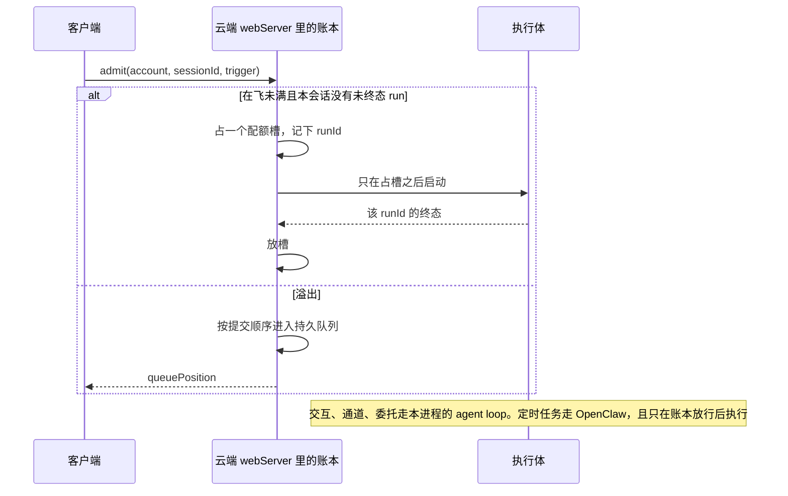

# ADR-087：云端 run 账本（准入、配额、终态）

- 状态：**已接受（方案 B，爸 2026-10-29 拍板）**。S4 仍须钉住运行时能「关闭自动响铃且保留强制 run」才合入，核对由 N-CLOUD-RUN-LEDGER-DESIGN-FU5 跟踪，在此之前 S4 保持 fail-closed
- 编号：原编号 ADR-086，与 ADR-086-native-dep-manifest 撞号，2026-10-29 改为 087
- 单号：N-CLOUD-RUN-LEDGER-DESIGN（只定合同，不改执行代码）
- 基线：`origin/main@0290e2990`（`0290e2990`，工作树 `mq/cloud-run-ledger-design`）
- 相关：[ADR-081](./ADR-081-execution-environment.md)（已接受：配额 2、同会话不并行、删除即释放）、[ADR-082](./ADR-082-cloud-cron-approval.md)（已接受：停车沿用同一 run）、[ADR-037](./ADR-037-durable-run-kernel.md)（一 run 一 owner）、[云端 run 工作区保留期设计稿](../designs/cloud-run-retention.md)（D1–D7 仍待拍板，本 ADR 不改那些数字）

## 决策记录

2026-10-29，爸在方案 A / B / C 中选定 B：账本排程云端定时任务，OpenClaw 只执行账本放行的那一次 run。
cron 令牌由云端 webServer 持有，定时 tick 也跑在云端 webServer 上；桌面不再是云端定时任务的排程方（迁移在 S4 落地）。
这收窄了 [ADR-081](./ADR-081-execution-environment.md) 里「`cronCloud.token` 继续只用于定时任务调度」一句：令牌今后放在服务端，不再放在桌面设置里。
S4 不合入，除非钉住的运行时能关闭自动响铃并仍执行强制 run（由 N-CLOUD-RUN-LEDGER-DESIGN-FU5 核对）。

## 术语

| 词 | 含义 |
|----|------|
| 账本 | 本 ADR 的云端 run 账本。它登记谁的 run、runId、sessionId、触发来源、队列顺序、在飞配额和终态。不是 ADR-033 的会话消息账本，也不是桌面 `DurableRunKernel` 的本地租约 |
| 账户 | 服务端已经验证过的用户。调用方随请求附带的用户字段不是账户 |
| 在飞 | 状态属于 `running`、`waiting-approval`、`waiting-reconnect` 的云端 run。排队中的不算 |
| 终态 | `succeeded`、`failed`、`cancelled`、`timed_out`、`interrupted`、`abandoned`。进入之后执行状态不再改回在飞 |
| 停车 | `waiting-approval`。同一 run 等人，不是终态（ADR-082） |
| 触发 | `manual`（人在客户端显式发起）、`cron`（到点）、`channel`（通道入站要上云）、`delegate`（委托要上云） |
| 执行体 | 真正跑这一轮的进程。交互、通道、委托用集群里这份 webServer 自己的 agent loop。定时任务用 OpenClaw，而且只执行账本已经放行的那一次 |
| 待核 (部署侧) | 要打开集群或钉住的 OpenClaw 二进制才能证实的事。本机没打开的，写成待核，不补情节 |

## 合同

下面七条是这一层必须提供的行为。每条注明需求从哪来。

### 1. 账户拥有 run

已验证的账户拥有这条 run。`accountId` 只从服务端的验证结果写入。

需求来自 N-CLOUD-CONCURRENCY-SRV 证据（2026-10-14）：现有 cronapi 用一枚服务级 Bearer 验明身份，没有账户主体；「Trusting a new caller-supplied user field would not establish ownership」。同一份证据要求 authoritative account-aware scheduler。ADR-081 把云端限定为同一主人，并写明 `cronCloud.token` 继续只用于定时任务调度，不拿来当执行环境的登记凭据。

今天对得上的代码：`authMiddleware` 调用 `verifyToken`，比对的是进程级 `CODE_AGENT_WEB_AUTH_TOKEN`（`src/web/middleware/auth.ts:verifyToken`，`src/shared/constants/webServer.ts:AUTH_TOKEN_ENV`）。桌面登录用户在 `AuthService.getCurrentUser`，并且只有 `hasVerifiedSession` 为真才算验证过的会话（`src/host/services/auth/authService.ts:getCurrentUser`）。集群里的 webServer 进程有没有这份已验证会话，本机没有打开运行中的进程，标待核 (部署侧)。没有已验证账户时，账本拒绝创建 run，稳定码 `CLOUD_RUN_ACCOUNT_REQUIRED`。

### 2. 稳定的 runId 和 sessionId

`runId` 由账本分配，写入之后不变。`sessionId` 同时写在同一行上。

需求来自 N-CLOUD-CONCURRENCY-SRV 的 stable `runId` and `sessionId`，以及 N-CLOUD-RUN-RETENTION-SRV：保留期要有权威的 runId 到工作区的映射。ADR-081 已拍板：交互云端轮写进账户域里的同一 `sessionId`，不新开一条云端线程。ADR-037：一个 run 一个 owner。

今天的云端定时声明把 `sessionTarget` 写成 `isolated`（`src/host/cron/cronApiClient.ts:cronApiMutableFields`）。`CronApiRun.runId` 是可选字段（`src/host/cron/cronApiClient.ts:CronApiRun`）。桌面在云端分支调用 `cloudRuntime.runJob` 之后把本地执行标成 `completed`，那是触发回执（`src/host/cron/cronService.ts` 云端分支）。回执上的完成不是这条 run 的终态，也不能代替账本上的 `sessionId`。

交互轮沿用已有 `sessionId`。定时工位仍然是隔离会话：账本行记下该隔离会话的 `sessionId` 和这一次的 `runId`，不以 `jobId` 代替 `runId`。

### 3. 四条触发都经过 admit

云端执行只有 `admit` 一个入口。`manual`、`cron`、`channel`、`delegate` 都调用它。还没接到 `admit` 的触发不得另开一条通往执行体的路。

需求来自 N-CLOUD-CONCURRENCY-SRV：「control over every trigger」。只在手工 `cron.run` 外面套队列，管不住 OpenClaw 自己的计时器。这一点是该证据的停止理由。

今天四条路各自为政：

| 触发 | 今天的入口 | 与配额的关系 |
|------|------------|--------------|
| manual | 云端定时的手工跑是 `CronCloudRuntime.runJob`；交互一轮是 `POST /api/run` | 两条都不读在飞配额 |
| cron | 桌面把任务登记给云端，OpenClaw 到点自己跑；桌面另外每 60 秒对账补登记 | 到点不经过本仓 |
| channel | `IngressPipeline.enqueue` | 入站队列，不是云端配额 |
| delegate | 会话内 `executeDelegateTask`；跨会话 `delegate_session` 在 ADR-072 写明当时还没有生产实现 | 会话内槽位池，不是每用户云端配额 2 |

`POST /api/run` 在 `src/web/routes/agent.ts`。`IngressPipeline` 在 `src/host/channels/ingressPipeline.ts`。`executeDelegateTask` 在 `src/host/tools/modules/commandCenter/sessionCommandCenter.ts`。事件定时今天不能上云：`assertEventScheduleConstraints`（`src/host/cron/cronEventTrigger.ts`）。

### 4. 可靠终态

终态是 `succeeded`、`failed`、`cancelled`、`timed_out`、`interrupted`、`abandoned`。`queued`、`running`、`waiting-approval`、`waiting-reconnect` 不是终态。终态一经写下，执行状态不再回到在飞。

需求来自 N-CLOUD-CONCURRENCY-SRV 的 reliable terminal transitions，以及保留期设计稿：清理时钟挂在终态上，停车期间不卸载（ADR-081）。ADR-082：批准之后继续同一 run，所以停车不是终态。N-CLOUD-RUN-RETENTION-SRV 要求终态和停车都有钩子可挂。

本地触发回执（`cronService` 把云端 `runJob` 的返回标成 `completed`）不写入这组终态。OpenClaw 的运行历史把 payload 执行和整次 run 的完成分开记。账本采纳终态时看整次 run：payload 成功但投递失败，记成 `failed`，不记成 `succeeded`。文档原句（[Manage automations](https://docs.openclaw.ai/automation/cron-jobs/managing-jobs)，2026-10-26）：

> Run history keeps payload execution in `status` (`ok`, `error`, or `skipped`) and whole-run completion in `completionStatus` (`succeeded`, `failed`, or `unknown`).

> Requested delivery is required unless the admitted job explicitly sets `delivery.bestEffort: true`; delivery-only failure leaves execution `status: "ok"`, does not increment execution error counters or enter retry backoff, and records `completionStatus: "failed"`.

钉住的 `openclaw-2026.7.1-2` 是否已有 `completionStatus`，标待核 (部署侧)。没有这个字段时，账本不把单独的 `status: ok` 升格为 `succeeded`。

### 5. 同步取消要确认执行体已经停

取消或删除在同一次调用里请求执行体停止，并等到**这一 `runId`** 进入终态，才释放配额、作废这一 run 的短期授权，并向调用方返回已取消。等到上限仍没有终态：返回 `CANCEL_REQUESTED`，配额继续占用。释放发生在终态落地的那次调用里；60 秒对账只补崩溃，不代替这次释放（ADR-081 不变量 5）。

需求来自 N-CLOUD-CONCURRENCY-SRV：synchronous cancellation that confirms the upstream actually stopped，以及「Releasing a local slot without stopping the upstream execution could exceed quota」。ADR-081 不变量 5：删除云端 run 立刻对账并释放配额，工人已经消失也要减，前提是消失已经被证实。

本仓已有同一诚实形状：`registerAgentCancelRoute` 里的 `waitForCancelSettlement` 看到 registry 卸下或 durable 终态才返回已取消，超时返回 `CANCEL_REQUESTED`（`src/web/routes/registerAgentCancelRoute.ts`）。上限是 `CANCELLATION_TIMEOUTS.ROUTE_SETTLE_WAIT`（15 秒，`src/shared/constants/timeouts.ts`）。云端取消沿用这个形状。15 秒是本机路由的等待，不是 OpenClaw 清理窗口；执行体更慢时调用方拿到未确认，槽不放。

OpenClaw 的删除响应里 `activeRunCancellationRequested: true` 只表示发出了取消请求。空的客户端进程也不是已停止。引用见 cron 一节。

### 6. 持久的 FIFO 和配额

每个账户同时在飞的云端 run 最多 2 条。第 3 条起按提交顺序排队。同一 `sessionId` 上已有未终态云端 run 时，下一次云端执行排队，不并行写。排队不占配额。已经登记、还没跑的定时任务不占配额；一旦被放行执行，计入同一个账户的 2。

这些数字是 ADR-081 已拍板 6 和 7，本 ADR 不改。持久化是 N-CLOUD-CONCURRENCY-SRV 的要求：账本拥有 FIFO 和配额状态，重启还在；对账只修崩溃。进程内存里的 Map 不能满足这一条。

### 7. 客户端能读到队列位置

拥有者能读到自己这条排队 run 的 `queuePosition`。位置从 1 起，只数同一账户的排队项，不把已经在飞的 run 算进位置。第一份溢出的 run 位置是 1。同一 `sessionId` 上因为串行而排着的项用同一套位置。读口同时给出 `ahead`：排在这一条前面的排队项数。位置 1 的 `ahead` 是 0。

需求来自本单任务书，以及 N-CLOUD-CONCURRENCY-SRV：「publish queue position/estimated start」。预计开始时刻只有在账本能从当前在飞 run 的已知期限推出来时才出现。推不出就省略该字段，不填一个估计值。

## 放在哪

账本放在 Neo 自己的云服务里：集群中的 agent-neo 进程，命令是 `node /srv/agent-neo/dist/web/webServer.cjs`。源码在本仓 `src/web/webServer.ts` 及其调用的 host。不改 OpenClaw 上游，不把配额做进 cronapi 的八项转发。

本机打开的部署清单是 `lobster-sealos@d184fad` 的 `k8s.yaml`：agent-neo 容器的 command 在 `:510`，工作目录 `/srv/agent-neo`，应用来自 PVC 子路径 `runtime-v2/agent-neo/app`（`:540`）。注释写明代码不走镜像仓，由本机构建灌进 PVC（`:503`）。因此「源码在本仓」指的是这份 webServer 的仓库；PVC 里此刻灌进去的构建是否等于本 ADR 的基线，标待核 (部署侧)。

cronapi 保持窄门转发。它不是准入层。N-CLOUD-CONCURRENCY-SRV 与 N-CLOUD-RUN-RETENTION-SRV 都是因为停在那一层才 BLOCKED。

## Cron：谁排程

**选定方案 B。账本自己排程。OpenClaw 只执行账本放行的那一次定时 run。**

交互、通道、委托不借 OpenClaw 的调度器。它们在云端 webServer 进程里执行。OpenClaw 只承接 `trigger = cron` 且 `admit` 已经占槽的调用。

### 引用：公开文档里没有可挂上的事前准入钩子

以下引文取自 2026-10-26 读取的 `https://docs.openclaw.ai`。它们描述的是文档站点当时的 Gateway，不是清单里的 `openclaw-2026.7.1-2` 二进制。二进制行为标待核 (部署侧)。

插件生命周期文档把外部 cron 集成定义成「投影唤醒快照」，并要求 OpenClaw 继续做至点判断和执行（[Gateway and install lifecycle hooks](https://docs.openclaw.ai/plugins/hooks/lifecycle)）：

> Keep OpenClaw as the source of truth for due checks and execution.

同页，`cron_changed` 是 Gateway 自己的生命周期观察，不是执行前的拒绝点：

> `cron_changed` fires for Gateway-owned cron lifecycle events with a typed event payload covering `added`, `updated`, `removed`, `started`, `finished`, and `scheduled` reasons.

> Treat these events as reconciliation hints, not an ordered delta log.

`started` 发生在运行已经开始之后。`scheduled` 同页写明是提交之后才发：

> A `scheduled` event is post-commit: it fires only after a successful durable write changes an existing job's effective `nextRunAtMs`

`before_agent_run` 是模型输入门，目录也不保证每条运行时都会发出它（[Plugin hooks](https://docs.openclaw.ai/plugins/hooks)）：

> Gate model input on a supported runner | `before_agent_run` → `{ outcome: "block", reason, message? }`

> The catalog is the registration API, not a promise that every runtime emits every hook.

> Do not rely on this hook as a Codex or Copilot input gate.

把配额放进这个钩子，权威仍在 Gateway 进程里的插件，而不是 Neo 的 webServer。本单不改 OpenClaw 上游，也不新增插件来充当准入。

文档给出了「自动调度关掉、手工执行仍可用」的开关（[Manage automations](https://docs.openclaw.ai/automation/cron-jobs/managing-jobs)）：

> Disable automatic runs: `cron.enabled: false` or `OPENCLAW_SKIP_CRON=1`. These settings do not prevent manual runs.

同页，单次强制执行与「仅在启用时跑」是分开的：

> Direct Gateway event sources can use `cron.run` with `mode: "if-enabled"` to run immediately without overriding an operator-disabled or auto-disabled job. Explicit operator run-now commands continue to use `force`.

手工执行的返回发生在入队时，不是终态（同页）：

> `openclaw automations run <jobId>` returns after enqueueing the manual run.

取消请求不等于已经停（[Automations (cron)](https://docs.openclaw.ai/cli/cron)）：

> When an operator removes an automation with an active run, OpenClaw requests cancellation of that run.

> The JSON removal response includes `activeRunCancellationRequested: true` when cancellation was requested.

> For an isolated automation, reusable-session cleanup then waits for the active run to stop and reports `sessionCleanup: "pending"` while cleanup is deferred.

空进程不是已停止（[How automations work](https://docs.openclaw.ai/automation/cron-jobs/how-it-works)）：

> Cron owns recovery and history for its own runs; an empty client process is not evidence that a Gateway run has stopped.

同一页，重复使用仍在飞的 run id 不会再起一条：

> Reusing a `--run-id` while the original Gateway run is still active reports the duplicate as in-flight instead of starting a second run.

同一页，没有记下终态的运行在重启后会变成 interrupted，并且启用中的定时 agent-turn 可能再跑一次：

> Without a recorded terminal result, an active run becomes interrupted with delivery **Unknown**. An enabled, unchanged, time-scheduled agent-turn job interrupted before delivery gets one fresh retry, including one-shot jobs.

有一条文档写明取消成功以终态为准，但是 tasks 面，不是 `cron.remove`（[Background tasks](https://docs.openclaw.ai/automation/tasks)）：

> Cancellation aborts only the selected live run and its pending approvals, and reports success only after that run settles as `cancelled`.

> Missing, already-terminal, ownerless, or unconfirmed runs do not report a new cancellation success.

`lobster-sealos@d184fad` 的 `cronapi/README.md` 成本闸一节写明这一层没有运行中的停止点：

> 在上游恢复非零 usage、补齐可审计的价格口径，并提供运行中 abort 控制点之前，不得把事后日志或空 usage 包装成预算保护。

N-CLOUD-CONCURRENCY-SRV 证据把同一边界记在 `cronapi/README.md:49-53`：`cron.remove` 不能被当成同步终止。该证据核对的提交是 `ae131de`。本机打开的是 `d184fad`，没有打开 `ae131de`，也没有打开集群。

### 方案

- **A。定时运行穿过账本，OpenClaw 继续排程。** 计时器仍在 OpenClaw，账本只包住手工 `cron.run`。做不到本单的「每条触发都经过 admit」：文档要求 OpenClaw 自己做至点判断和执行，观察钩子在 `started` 之后才通知外部。要让计时器先问账本，就得改 OpenClaw。否决。
- **B。账本排程，OpenClaw 只执行。** 选定。用户眼中的定时任务仍由 Neo 保存声明。写到 OpenClaw 的任务不自动响铃：优先按任务关掉自动执行，放行时用强制 `cron.run`。若钉住的运行时没有「单任务关闭、强制 run 仍执行」这道分裂，就退到 Gateway 级 `cron.enabled: false` 或 `OPENCLAW_SKIP_CRON=1`，并且只在确认手工 run 仍可用之后才合入。两道开关在上面的文档里都有；`openclaw-2026.7.1-2` 是否实现，标待核 (部署侧)。没证实之前，对应切片 fail-closed，不改回方案 A。
- **C。用 `before_agent_run` 当配额门。** 否决。那是模型输入门，不分配 runId，不持有 FIFO，也不向调用方确认执行体已停。插件住在 OpenClaw 进程里，跟「放在 Neo 自己的云服务」相反。

桌面今天每 60 秒把云端清单里缺失的任务再登记一次（`src/host/cron/cronCloudRuntime.ts` 的 `RECONCILE_INTERVAL_MS` 与 `reconcile`）。方案 B 合入之后，这次补登记不得把 OpenClaw 的自动响铃重新打开。用户级的「启用」只表示账本会到点放行。

账本在调用 `CronApiClient.runJob` 之前占槽。`runJob` 返回只表示 OpenClaw 接收入队（文档：returns after enqueueing）。槽一直占到该 `runId` 的终态。账本不同时发出超过剩余配额的执行调用，避免 OpenClaw 自己的执行槽再堆出第 3 条在飞 run。

## 失败模式

### 重启时 run 还在飞

账本进程重启后，FIFO 和在飞集合从持久存储读回，不从空表开始。已经在飞的 payload 不因为重启而再执行一遍。

对每一条 `running` 的行，向执行体核对这一 `runId`：

- 执行体已有终态：账本写下同一终态并放槽。
- 执行体仍在跑：保持占槽。
- 执行体没有这一行：记 `interrupted` 并放槽。不把它记成 `succeeded`。

60 秒对账只做上述补救。OpenClaw 文档写明，启用中的定时 agent-turn 在没有终态记录时可能自动再试一次。方案 B 关掉自动响铃，就是为了去掉这第二次。若钉住的二进制在自动调度已关时仍会重试，标待核 (部署侧)；账本见到同一 `runId` 的第二次执行请求时返回已有行，不分配新 `runId`，不占第二个槽。已经发生的工具副作用不在本 ADR 里承诺 exactly-once。

### 取消时执行体不返回

账本发出停止请求后，按合同第 5 条等待。超时则调用方得到 `CANCEL_REQUESTED`，配额仍占。再次取消返回同一次未确认的结果，不新发一条逻辑上的第二次删除。后台对账继续等这一 `runId`。在终态出现之前，本地行不得写成 `cancelled`。

OpenClaw 文档里的 `sessionCleanup: "pending"` 与 `activeRunCancellationRequested` 都落在「未确认」这一支，不落在「已取消」。

### 同一次触发来了两遍

幂等键：

- 定时：`(accountId, jobId, slot)`。`slot` 是这一次计划时刻。同一槽的第二次 `admit` 返回已有 `runId` 和已有位置。
- 交互与委托：`(accountId, sessionId, clientMessageId)`。没有 `clientMessageId` 的请求不套用前一次的结果。
- 通道：`(accountId, channelDeliveryId)`。

OpenClaw 文档写明，仍在飞的 `--run-id` 被再用时报告 in-flight，不启动第二条。账本把这当作执行体侧的保护，自己的幂等键仍然先挡。桌面补登记、客户端重试、账本重启补发，这三件事叠在一起时只占一个槽。

同一 `sessionId` 上另一条不同的云端输入仍按合同第 6 条排队，那是串行，不是重复触发。

## 切片

每片可以单独合进 main。后一片只依赖已经在 main 上的前序行为，不依赖未合并的分支。合入用本仓的门；本 ADR 不部署。

| 片 | 解锁 | 范围 | 验收 | 依赖 |
|----|------|------|------|------|
| S1 持久 run 行 | **N-CLOUD-RUN-RETENTION-SRV** | 云端 webServer 里的 run 存储。字段：`accountId`、`runId`、`sessionId`、`trigger`、执行状态、`workspaceId`、`workspaceStatus`，以及保留期证据列 `retentionNoticeAt`、`exportAvailable`（可空，本片不写提醒、不导出）。状态迁移写成可订阅的记录：进入终态、进入或离开 `waiting-approval`。工作区只挂这一 `runId`，不挂可共享的环境对象 | 无已验证账户则插入失败且稳定码为 `CLOUD_RUN_ACCOUNT_REQUIRED`；请求体里的用户字段不成为 `accountId`；终态行不能再标成 `running`；停车不是终态；重启后同一 `runId` 仍指向同一 `workspaceId`。保留期设计稿的 D1–D7 不在本片拍板 | 无 |
| S2 准入、FIFO、配额、队列位置 | 不解锁 CONCURRENCY-SRV。它让 **N-CLOUD-CONCURRENCY-QUEUE-UI** 有稳定读口 | `admit` 与只读的队列位置。在飞最多 2，同一 `sessionId` 最多一条未终态，溢出按提交顺序进持久队列。本片只把「环境选择为云端」的 `POST /api/run` 接上 `admit` | 在飞已有 2 条时，下一次 admit 得到 `queued` 且 `queuePosition` 为 1；再下一次为 2。重启后这两个位置仍在。同会话第二条排队且不占配额。只登记未执行的定时任务不占配额。排队读口不接受另一个账户的 `runId` | S1 |
| S3 同步取消 | 不单独解锁。CONCURRENCY-SRV 的取消条款由本片实现，和 S4 一起才算层完整 | 对账本 `runId` 请求执行体停止，等待终态后放配额。超时返回 `CANCEL_REQUESTED` 且配额仍占。删除走同一条。重复取消返回同一结果 | 执行体仍在跑时响应不是已取消；终态写入后该账户在飞数减 1；超时响应码是 `CANCEL_REQUESTED`；第二次取消不释放两次 | S1。测试可以插入一条 `running` 行，不需要 S2 的队列 |
| S4 触发收口与账本排程 | **N-CLOUD-CONCURRENCY-SRV** | 定时声明不再让 OpenClaw 自动响铃；到点由账本 `admit` 之后强制执行。`CronCloudRuntime.runJob` 与 60 秒补登记改走账本。通道与委托要启动云端 run 时只能调用 `admit`；未接线的调用点不能直接碰到执行体。钉住运行时若不能「关闭自动响铃且保留强制 run」，本片不合入 | 未经过 `admit` 的计时器不产生新的在飞行；四条触发的旁路调用不增加在飞数；同一账户的队列位置对四条触发是同一个读口；补登记之后 OpenClaw 任务仍不自动响铃 | S2、S3 |

S1 合入之后，N-CLOUD-RUN-RETENTION-SRV 可以在这张 run 行上挂清理 sweep。sweep、提醒发送、导出端点仍是那张单和 N-CLOUD-RUN-RETENTION-EXPORT 的范围。本 ADR 只保证终态、停车和 `workspaceId` 有地方可写。

S4 合入之后，N-CLOUD-CONCURRENCY-SRV 的前提成立：账户、runId、四条触发、终态、同步取消、持久 FIFO 与配额、队列位置都在这一层。该单改为对着这些验收补测试，而不是在 cronapi 上再做一套计数器。

下游四张单与切片的关系：

| 下游 | 可以开工的条件 |
|------|----------------|
| N-DELEGATE-SESSION | S4。委托上云只有 `admit(trigger = delegate)` |
| N-CLOUD-CONCURRENCY-QUEUE-UI | S2。位置读口已在，S4 之后四条触发共用 |
| RETENTION-EXPORT | S1。导出读 `workspaceId`；`exportAvailable` 列已在 |
| PROJECTION | S1。终态与 `workspaceStatus` 已在 run 行上。投影若要改 cron SSE 的事件名，仍走 ADR-082 的显式白名单，不在本 ADR 里加第 9 个方法 |

## 非目标

- 不改 OpenClaw 源码，不在集群里装插件，不部署，不改 PVC。
- 不改 cronapi 的八项白名单，不加 `cron_approval`。那是 ADR-082 的施工单。
- 不拍保留期天数、提醒次数、续期次数。那些是保留期设计稿的 D1–D7。
- 不把桌面 `DurableRunKernel` 的租约搬到云端再抄一份。云端工人认领已有 `runId` 仍用 ADR-037 的 epoch 交接；配额与队列是本账本的新状态。
- 不估算价格，不改配额数字 2。

## 待核 (部署侧)

本机没有部署，没有打开集群，没有读取密钥。下面这些未在本机证实：

- 运行中的 Pod 是否仍等于 `lobster-sealos@d184fad` 的清单。该提交的清单里，镜像是 `ghcr.io/openclaw/openclaw:2026.6.6-browser`（`k8s.yaml:111`），进程入口是 `node /opt/openclaw/tools/openclaw-2026.7.1-2/openclaw.mjs gateway run`（`k8s.yaml:137`），副本数 `replicas: 1`（`k8s.yaml:91`）是 Pod 数，不是 run 配额。N-CLOUD-CONCURRENCY-SRV 证据在 `ae131de` 上看到同一入口路径。两个提交本机只打开了 `d184fad`。
- `openclaw-2026.7.1-2` 是否具有本文引用的 2026-10-26 文档行为：观察钩子、`cron.enabled: false`、强制 `cron.run`、`tasks.cancel` 以 `cancelled` 为成功。
- PVC 中的 `webServer.cjs` 是否包含 `AuthService` 的已验证会话。
- Gateway 上除 Neo 以外是否还有别的定时任务。方案 B 的 Gateway 级开关会影响同一 Gateway 上的全部自动定时任务；单任务关闭自动执行是默认手段，就是为了避免这件未证实的事。
